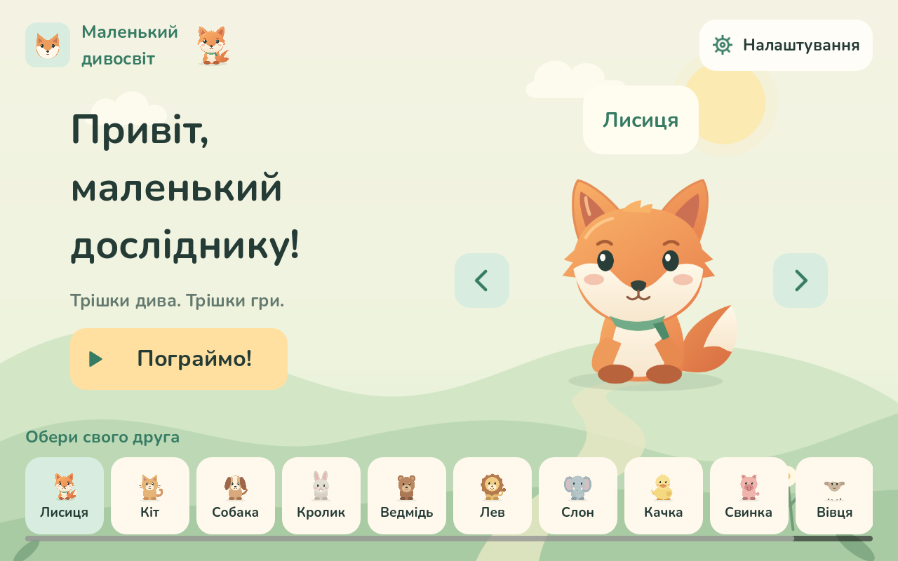
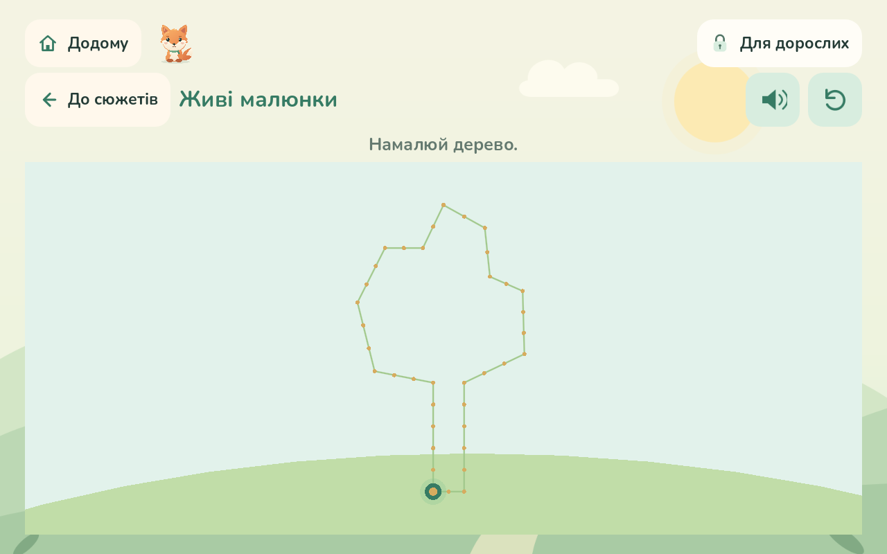
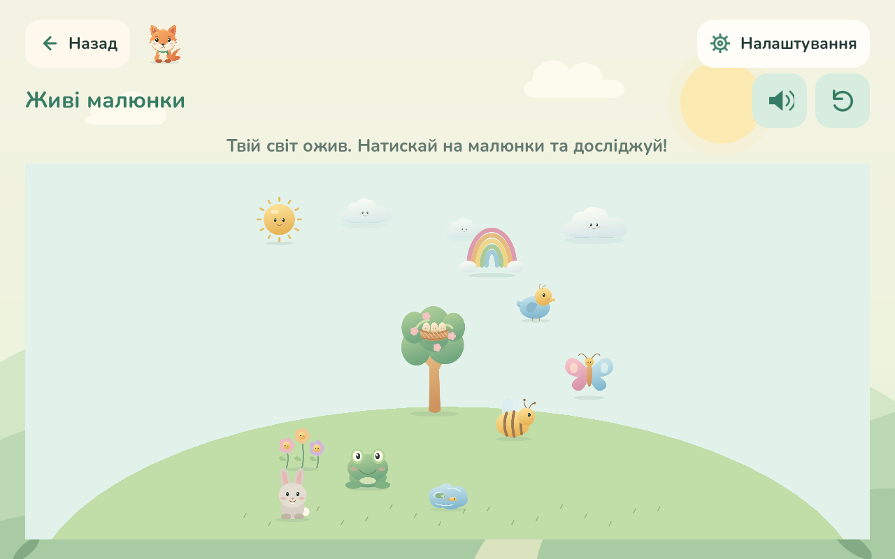
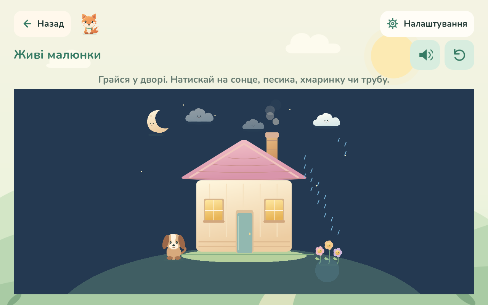
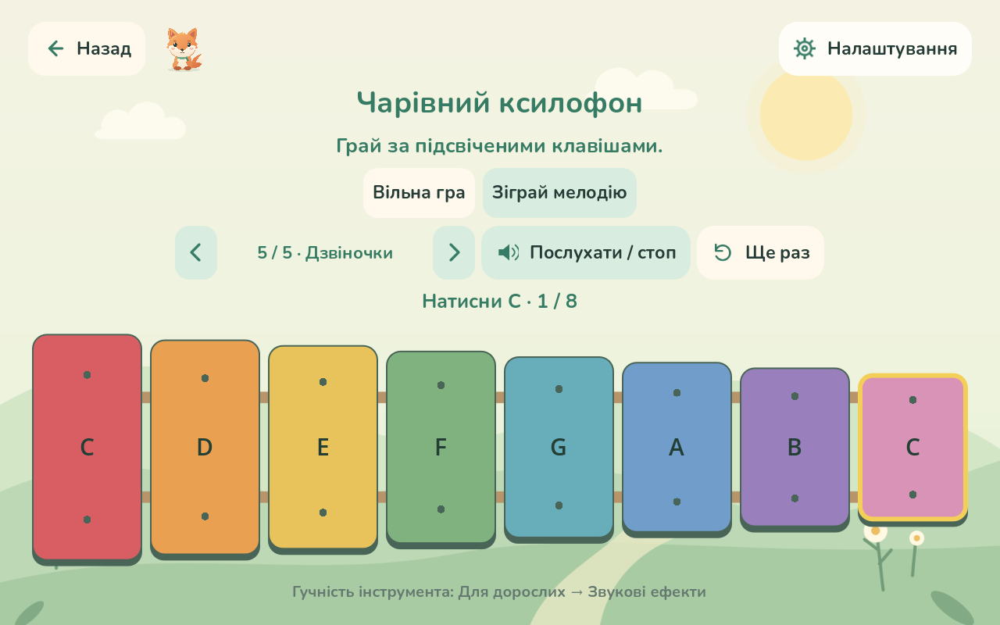

# Little Wonder World

**Offline learning through play for ages 3–5** · **v0.32.0** · **English and Ukrainian**

Choose an animal companion and explore a meadow full of short games, drawing activities and music. Spoken instructions and vocabulary are available offline.

## Game catalog

### Words and discovery

| Activity | What you can do |
| --- | --- |
| **Animals** | Tap illustrations to hear animal names, then find the animal you hear. |
| **Colors** | Learn color names and pick the requested color. |
| **Snack time** | Listen to a request and drag the matching food to the animal. |
| **Letters** | Hear letter names, browse illustrated examples and trace uppercase letters. |
| **Build a word** | Assemble words from letters using picture clues. Choose a word or play a shuffled round. |
| **Discover the world** | Explore animals, body parts and plants. Try short quizzes and compare previous results. |

### Puzzles and numbers

| Activity | What you can do |
| --- | --- |
| **Shape garden** | Drag each shape to its matching outline. |
| **Animal puzzles** | Pick a picture or play a shuffled round, then put its pieces together. |
| **Find the pairs** | Turn over cards and match pictures. Choose the pictures or play a shuffled round. |
| **Numbers and counting** | Count a group and pick the number, put the requested number of objects in a basket, or trace digits. |

### Drawing, music and play

| Activity | What you can do |
| --- | --- |
| **Magic drawing** | Draw freely with brushes, solid colors and gradients. Save drawings to the gallery and export them as PNG from the grown-ups area. |
| **Coloring book** | Tap inside an outline to fill it. Turn on a color example for inspiration or make your own palette choices. |
| **Living drawings** | Trace parts of a picture, then tap the finished scene to play with its characters and animations. Explore a house and yard, a spring garden, an autumn scene and a winter scene. |
| **Draw a word** | Pick a word prompt and draw it. Play on your own or take turns guessing in family mode. |
| **Magic xylophone** | Play freely or follow the highlighted keys through five short melodies. |
| **Balloon meadow** | Pop balloons at your own pace or try a timed challenge and beat your local record. |
| **Friends’ meadow** | Spend time with your chosen companion and discover its reactions. |

## A closer look at Living drawings

| Follow the guide | Play in the spring garden | Explore the house at night |
| --- | --- | --- |
|  |  |  |

Settings, progress and artwork stay on the device. Grown-ups can choose the language, adjust difficulty and sound, or enable Ukrainian vocabulary translations in English mode.

[Run or build the project](docs/DEVELOPMENT.md) · [Architecture](docs/ARCHITECTURE.md) · [Version history](CHANGELOG.md) · [Asset credits](assets/PROVENANCE.md)
